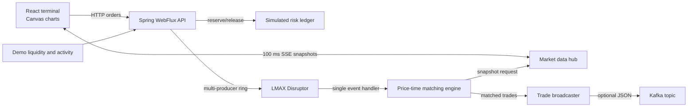

# Architecture

## Order lifecycle

1. WebFlux validates the request. The gateway checks the supported demo symbol/account and computes the protected price for market orders.
2. The risk ledger atomically reserves simulated buying power or shares before a command enters the multi-producer Disruptor ring.
3. One dedicated event handler serializes all book mutations. The Disruptor preallocates its reusable event slots; HTTP DTOs, futures, orders, trades, and market snapshots still allocate. Price levels use ordered maps and FIFO queues; marketable orders trade against the best opposite price first. Self-trades are prevented.
4. Filled units settle the simulated ledger; unfilled market quantity is released; limit remainders rest until matched or canceled.
5. A scheduler requests a consistent book snapshot every 100 ms and broadcasts it through a replay-latest Reactor sink to SSE clients. Matching snapshots are protected from concurrent reads; this is not a claim that every component is lock-free.
6. Matched trades update recent executions and one-minute candles. Kafka publication is an optional asynchronous downstream adapter.

## Evolving simulated market

The liquidity simulator replaces its own account's standing orders every 650 ms with seven price levels per side, variable quantities and a narrow changing spread. Its stochastic momentum model evolves the quote midpoint; it does not pin the book to the opening price. Independently funded opposing market flow generates actual matches. The entire two-sided quote refresh is one Disruptor command under the engine's snapshot lock, so clients cannot observe the temporary gap between removing old quotes and adding replacements. Cancellations release the remaining cash/share reservations without touching the student's orders.

Startup replays 720 sets of simulated orders at five-second historical intervals, giving 60 minutes of genuine engine-produced OHLC/volume immediately. A replay clock timestamps those matches and is restored to wall time before regular activity starts. Replay prints are simulated history, not retrieved exchange history. Both the initial chart and its ongoing updates are derived from matched executions; the frontend only aggregates one-minute candles into requested 5m or 15m buckets and renders them. No random prices or candles are generated in the browser.

## Local API

- `GET /api/health`
- `GET /api/market/snapshot`
- `GET /api/market/stream` (Server-Sent Events, JSON event data)
- `POST /api/orders` with `{ "symbol":"ORDF", "accountId":"student", "side":"BUY", "type":"LIMIT", "priceTicks":9995, "quantity":10 }`
- `POST /api/orders/{orderId}/cancel?accountId=student`
- `POST /api/shutdown` (local terminal's Quit action; requires `X-OrderFlow-Action: quit`)

Prices are integer cents/share. A market order uses a 5% protection band from the current best opposite quote; its unmatched remainder is canceled. Demo orders can be placed with `student`, `market-maker`, and `demo-flow`.
